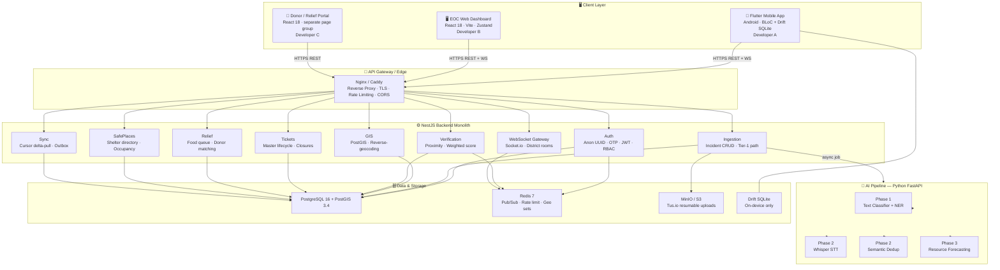
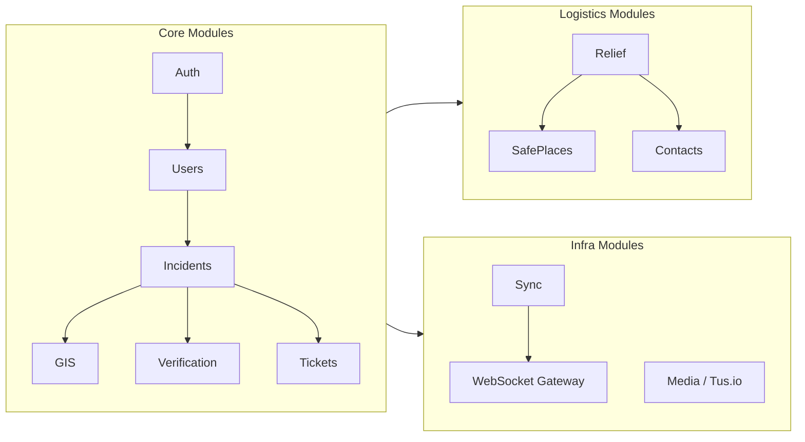
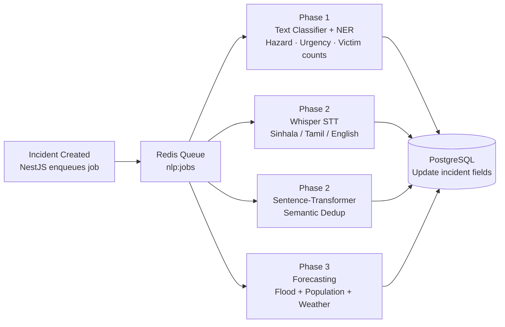
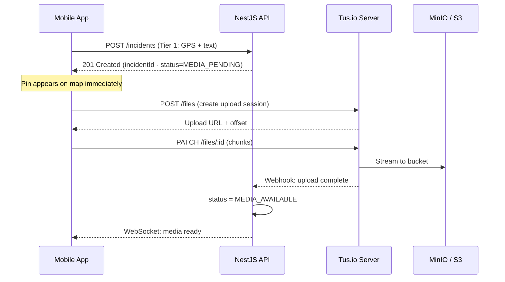
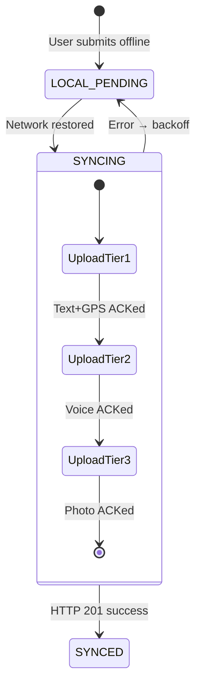
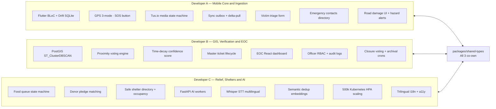
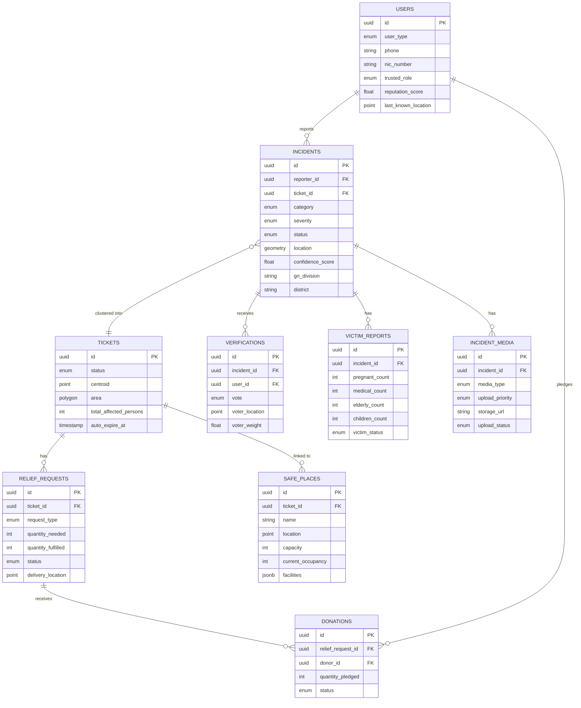
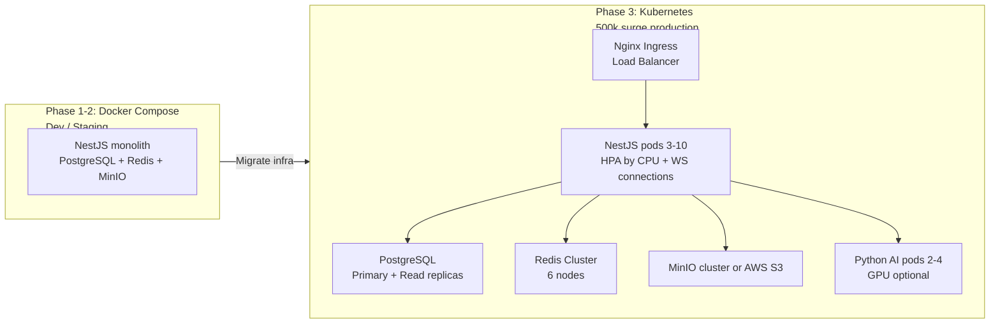

# FloodBlast — Recommended System Architecture
> **Disaster Management Platform · Sri Lanka**  
> _Text & Location First → Voice Second → Images Third → Videos Last_  
> _Target: 2G/EDGE resilience · 500k concurrent surge capacity · Offline-first_

---

## 1. Architecture Overview

The architecture is a **layered, offline-first monorepo** organized into three client surfaces and a microservice-ready backend, underpinned by a spatial database and a lightweight AI pipeline. It follows a **vertical domain ownership** model matching the 3-developer workload split in the SRS.



---

## 2. Layer-by-Layer Breakdown

### 2.1 Mobile Client — Flutter 3.x (Developer A)

| Concern | Solution |
|---|---|
| **State Management** | BLoC (`AuthBloc`, `MapBloc`, `IncidentBloc`, `ContactsBloc`) |
| **Local Database** | Drift (SQLite) — incidents, sync outbox, contacts cache |
| **Offline-First** | Transactional Outbox Pattern → `LOCAL_PENDING` → sync on reconnect |
| **GPS** | 3-mode adaptive: Passive (cell tower) · Active (15–30s) · SOS (15s burst) |
| **Maps** | Google Maps SDK · custom disaster markers · 10k+ cluster rendering |
| **Media Pipeline** | Tier 1 (1–2 KB text/GPS) → Tier 2 (Opus voice) → Tier 3 (WebP photo) → Tier 4 (video, WiFi/4G only) |
| **Media Upload** | Tus.io resumable chunked: `MEDIA_PENDING` → `MEDIA_AVAILABLE` |
| **Network Retry** | Exponential backoff with jitter on reconnect |
| **Sync** | `GET /sync/pull?since=TIMESTAMP&district=X` cursor-based delta |
| **i18n** | Sinhala · Tamil · English (flutter_localizations) |
| **Battery** | Dark OLED mode default; adaptive GPS; SQLite over heavy JSON |

**Key Screens:**
- Welcome / Zero-login anonymous entry
- Full-screen Google Map (incident markers, safe places, road overlays)
- Multi-step incident form: Category → Description → Photo → Victims → Submit
- 1-tap SOS button (pulsing radial rings animation hint)
- Location-aware emergency contacts (1-tap `tel:` dialer)
- Road damage overlay + 2 km hazard warnings

---

### 2.2 EOC Web Dashboard — React 18 (Developer B)

| Concern | Solution |
|---|---|
| **Framework** | Vite + React 18 + TypeScript |
| **State** | Zustand (authStore, mapStore, notificationStore) |
| **Data Fetching** | TanStack Query (caching, refetch, optimistic updates) |
| **Realtime** | Socket.io client → district-partitioned WebSocket rooms |
| **Maps** | Google Maps JS API — color-coded pins, road overlays, cluster heatmaps |
| **RBAC UI** | Role-gated routes (officer vetting, audit logs, broadcast alerts) |

**Key Views:**
- National situational awareness map
- Incident list with severity/status filters
- Master Ticket detail (merge tool, closure voting, activity log)
- Officer management & vetting panel
- Road hazard overlay + directional blockage indicators

---

### 2.3 Donor / Relief Portal — React 18 (Developer C)

A separate **React page group** (or sub-route) within the web dashboard:
- Relief request board (food queues by meal window, medical supplies)
- Pledge wizard (partial quantity, real-time progress bar)
- Safe shelter directory with occupancy meters
- Donor history & delivery status tracker
- Trilingual toggle (Sinhala / Tamil / English)

---

### 2.4 Backend — NestJS Monolith → Microservices Path



> [!NOTE]
> **Phase 1–2:** Single NestJS monolith (current scaffold). Modules communicate in-process.  
> **Phase 3+:** Split AI workers into Python FastAPI service. If surge demands it, extract GIS Module and Sync Module as independent microservices behind Redis Streams.

#### Critical Backend Flows

**Tier-1 Fast Ingestion (< 500 ms SLA):**
```
Mobile POST /incidents
  → Auth guard (JWT decode, cached in Redis)
  → IncidentsService.create()
  → PostGIS resolveLocation()   ← GN / DS / District
  → incidentRepository.save()
  → EventsGateway.emit('incident:new', districtRoom)
  → HTTP 201 response           ← < 500ms
  → [async] NLP job enqueued in Redis
  → [async] Tus.io media upload starts
```

**Verification Confidence Engine:**
```
POST /verifications/:incidentId
  → ST_DWithin check (500m–1km enforcement; > 5km → 403)
  → Weight: Citizen 1.0 / Registered 2.0 / Officer 10.0
  → Score = Σ(w_i × V_i) × e^(-λ(t-t₀))
  → Atomic Redis score update
  → Status: UNVERIFIED → VERIFIED (≥5.0) or DISMISSED (<0)
  → WebSocket push to district room
```

---

### 2.5 Geospatial Engine — PostgreSQL + PostGIS

| Function | PostGIS Operation |
|---|---|
| Admin boundary reverse-geocoding | `resolve_admin_location(lng, lat)` → GN → DS → District → Province |
| Incident deduplication clustering | `ST_ClusterDBSCAN` within 75–100m radius, by category |
| Proximity voting gate | `ST_DWithin(voter_location, incident_location, 1000)` |
| Nearby incidents lookup | `find_nearby_incidents(lng, lat, radius_meters)` |
| Road hazard polygon | `ST_Intersects(route_line, hazard_buffer)` |
| Bounding-box map query | `ST_MakeEnvelope(minLng, minLat, maxLng, maxLat, 4326)` |

**Spatial Index Strategy:**
```sql
CREATE INDEX idx_incidents_location   ON incidents   USING GIST(location);
CREATE INDEX idx_safe_places_location ON safe_places USING GIST(location);
CREATE INDEX idx_admin_boundaries     ON admin_boundaries USING GIST(boundary);
```

---

### 2.6 Redis Usage Map

| Use Case | Data Structure |
|---|---|
| Incident confidence scores | `ZADD` Sorted Set `incidents:scores` |
| Rate limiting (3 reports/hr/device) | `INCR` + `EXPIRE` on `device:{uuid}:hour:{H}` |
| District WebSocket pub/sub | `PUBLISH district:{name}` channel |
| Session / JWT cache | `SET jwt:{userId}` with TTL |
| Geo-sorted active incidents | `GEOADD incidents:active lng lat incidentId` |
| NLP job queue | `RPUSH nlp:jobs` / `BLPOP` worker |
| Mock GPS detection | `SET device:{uuid}:last_location` with velocity check |

---

### 2.7 AI / NLP Pipeline — Python FastAPI (Developer C)



| Phase | Model | Output |
|---|---|---|
| **1** | DistilBERT fine-tune | Hazard category + urgency score |
| **1** | spaCy NER | Victim counts (pregnant, elderly, etc.) |
| **2** | Whisper small/medium | Transcribed Sinhala/Tamil/EN text |
| **2** | `all-MiniLM-L6-v2` | Cosine similarity for semantic dedup |
| **2** | LLM prompt | 3-line EOC situational summary |
| **3** | Gradient Boosting | Resource demand forecast |

---

### 2.8 Media Pipeline — Tus.io Resumable Uploads



---

### 2.9 Offline-First Sync State Machine



**Delta Sync Pull:**
```
GET /sync/pull?since=2026-11-19T05:00:00Z&district=Colombo&limit=200
→ { incidents[], tickets[], safePlaces[], contacts[], serverTimestamp, hasMore }
→ Mobile upserts into Drift SQLite by ID
→ Updates local cursor to serverTimestamp
```

---

## 3. Developer Domain Ownership



---

## 4. Data Architecture — Key Entities



---

## 5. API Design Principles

| Principle | Implementation |
|---|---|
| **REST + WebSocket** | REST for CRUD; Socket.io for realtime incident/district push |
| **Fast Tier 1 path** | Incidents endpoint returns 201 < 500 ms; AI/media async |
| **Cursor-based sync** | `?since=ISO8601&district=X&limit=200` — no offset pagination |
| **Idempotent POSTs** | `Idempotency-Key` header for safe offline retries |
| **Anonymous-first** | No auth required for reads; device UUID for writes |
| **Spatial filtering** | Bounding box params (`minLat`, `maxLat`, `minLng`, `maxLng`) on map queries |
| **Versioning** | `/api/v1/` prefix — ready for v2 without breaking mobile clients |

---

## 6. Security Architecture

| Threat | Mitigation |
|---|---|
| Mock GPS / location spoofing | Velocity check: distance/time > 300 km/h → flag `SUSPICIOUS_LOCATION` |
| Report flooding (DoS) | Redis rate limit: 3 reports/hr per `device:{uuid}` |
| Remote verification spam | PostGIS `ST_DWithin` gate: voters > 5 km → HTTP 403 |
| Replay attacks | JWT short TTL (15 min) + refresh tokens in Redis |
| Media injection | Presigned MinIO URLs + server-side MIME type validation |
| Anonymous abuse | Device fingerprint bans via Redis blocklist |
| PII exposure | Phone numbers never returned in public payloads; opt-in only |

---

## 7. Scalability Plan



> [!IMPORTANT]
> The WebSocket gateway is the **primary scaling bottleneck**. Use `socket.io-redis` adapter from day one so any NestJS pod can emit to any client via Redis Pub/Sub.

---

## 8. Build Status vs. Remaining Work

### ✅ Done (Phases 1–4 Scaffold)
- Monorepo structure (`apps/mobile`, `apps/server`, `apps/web-dashboard`, `packages/shared-types`)
- Docker Compose: PostgreSQL 16 + PostGIS 3.4, Redis 7, MinIO
- NestJS modules: Auth, GIS, Users, Incidents, Verification, Contacts, Sync, Tickets, WebSocket Gateway
- Flutter BLoC structure, Drift SQLite schema, GPS service, API client, background sync engine
- React EOC dashboard: map, incident list/detail, contacts, auth

### 🔧 Remaining (Developer Assignments)

| FR Group | Owner | Key Work |
|---|---|---|
| Zero-login, Device UUID, GPS confidence UI | **Dev A** | Flutter UX + Drift persistence |
| Multi-hazard form, 1-tap SOS, Tus.io upload | **Dev A** | Media state machine |
| Victim triage, road damage, emergency directory | **Dev A** | Flutter screens |
| Offline outbox, delta-sync, battery/RAM tuning | **Dev A** | NFRs |
| PostGIS `ST_ClusterDBSCAN` master tickets | **Dev B** | Backend SQL |
| Proximity voting engine, time-decay, anti-abuse | **Dev B** | Backend + Redis |
| EOC master ticket merge UI, closure voting, crons | **Dev B** | Backend + React |
| Food queue state machine, donor pledge matching | **Dev C** | Backend + React |
| Safe shelter directory, occupancy tracking | **Dev C** | Backend + React |
| FastAPI AI: Whisper STT, NER, dedup, forecast | **Dev C** | Python pipeline |
| Kubernetes HPA, trilingual i18n, accessibility | **Dev C** | NFRs |

---

## 9. Recommended Additions

> [!TIP]
> These are not in the current SRS but would significantly improve reliability or developer velocity.

1. **BullMQ (Redis-backed job queues):** Use BullMQ for NLP jobs, Tus.io completion webhooks, and cron-based archival tasks — already compatible with NestJS stack.

2. **`socket.io-redis` adapter from Day 1:** Critical for WebSocket scaling across multiple NestJS pods. Add before writing any WebSocket logic.

3. **PostGIS Read Replica:** Writes → primary (< 500 ms SLA); heavy `ST_ClusterDBSCAN` and sync queries → streaming read replica.

4. **CDN for Map Tiles & Media:** Serve MinIO-stored WebP images and cached offline map tiles through Cloudflare / BunnyCDN to cut 2G mobile data consumption.

5. **OpenTelemetry + Pino Structured Logging:** Add distributed tracing (Jaeger/Tempo) and structured JSON logs early — invaluable during a live disaster surge when you need to debug in real time.

6. **Flutter Feature Flags:** Use Firebase Remote Config or a simple Redis-backed flag endpoint to progressively enable Phase 2/3 AI features without a full app release.

7. **Dedicated SMS Microservice:** Wrap Dialog Ideamart / SLT-Mobitel integration in a small separate service so a carrier API outage never affects the main backend.
