# FloodBlast — Hosting Efficiency Audit

> Analysed against the current monorepo structure as of 2026-11-19.

---

## Verdict: Good Foundation, 7 Critical Gaps

The domain structure and service separation are **correct**. What's missing is the **deployment plumbing** that turns working source code into something that can actually be hosted reliably. None of the gaps are architectural — they are all operational.

---

## ✅ What Is Already Efficient

| Area | Why It's Good |
|---|---|
| **Monorepo layout** (`apps/` + `packages/`) | Each service builds and deploys independently. No cross-service coupling at deploy time. |
| **`packages/shared-types`** | Single source of truth for types. No drift between server and client contracts. |
| **NestJS Fastify** (detected in `package.json`) | Fastify is 2–3× faster than Express under load — smart choice for the < 500 ms SLA. |
| **PostgreSQL + PostGIS in Docker Compose** | Portable, reproducible infra. PostGIS spatial index setup in `init-db.sql` is correct. |
| **Redis + MinIO in Compose** | Both services are correctly volume-mounted for data persistence across restarts. |
| **Vite build** for web dashboard | Produces an optimised static bundle — can be served from a CDN or Nginx directly. |
| **Python FastAPI AI service** already has a `Dockerfile` | The only app that is container-ready right now. |

---

## ❌ Critical Gaps (Will Fail at Hosting Time)

### Gap 1 — Missing Dockerfiles for Server and Web Dashboard

```
MISSING: apps/server/Dockerfile
MISSING: apps/web-dashboard/Dockerfile
```

**Impact:** You cannot containerise or deploy either service. Without these, Kubernetes, Railway, Render, and any CI/CD pipeline cannot build the app.

**Fix — `apps/server/Dockerfile`:**
```dockerfile
FROM node:20-alpine AS builder
WORKDIR /app
COPY package*.json ./
COPY apps/server/package*.json ./apps/server/
COPY packages/shared-types/package*.json ./packages/shared-types/
RUN npm ci --workspace=apps/server --workspace=packages/shared-types
COPY packages/shared-types ./packages/shared-types
COPY apps/server ./apps/server
RUN npm run build --workspace=apps/server

FROM node:20-alpine AS runner
WORKDIR /app
ENV NODE_ENV=production
COPY --from=builder /app/apps/server/dist ./dist
COPY --from=builder /app/node_modules ./node_modules
EXPOSE 3000
CMD ["node", "dist/main"]
```

**Fix — `apps/web-dashboard/Dockerfile`:**
```dockerfile
FROM node:20-alpine AS builder
WORKDIR /app
COPY apps/web-dashboard/package*.json ./
RUN npm ci
COPY apps/web-dashboard .
RUN npm run build          # outputs to /app/dist

FROM nginx:alpine AS runner
COPY --from=builder /app/dist /usr/share/nginx/html
COPY apps/web-dashboard/nginx.conf /etc/nginx/conf.d/default.conf
EXPOSE 80
```

> [!CAUTION]
> Without multi-stage builds (shown above), your Docker images will be **400–800 MB** instead of **80–120 MB**. This slows every deploy and wastes memory on the host.

---

### Gap 2 — Docker Compose Only Has Data Services (No App Services)

The current `docker-compose.yml` only starts **PostgreSQL, Redis, and MinIO**. In production, the NestJS server and AI service also need to be in the compose or Kubernetes manifests.

**Impact:** You have to manually start `npm run start:prod` and `uvicorn` on the server. This breaks on any restart and cannot be managed by an orchestrator.

**Fix — add to `docker-compose.prod.yml`:**
```yaml
services:
  server:
    build:
      context: .
      dockerfile: apps/server/Dockerfile
    env_file: .env
    ports:
      - "3000:3000"
    depends_on:
      postgres:
        condition: service_healthy
      redis:
        condition: service_healthy
    restart: unless-stopped

  ai-service:
    build:
      context: apps/ai-service
      dockerfile: Dockerfile
    env_file: apps/ai-service/.env
    ports:
      - "8001:8001"
    depends_on:
      - redis
    restart: unless-stopped

  web-dashboard:
    build:
      context: .
      dockerfile: apps/web-dashboard/Dockerfile
    ports:
      - "80:80"
    depends_on:
      - server
    restart: unless-stopped
```

---

### Gap 3 — No `.dockerignore` Files

**Impact:** Every Docker build copies your entire `node_modules/`, `.git/`, and Flutter build artifacts into the build context. A simple `npm install` step uploads **hundreds of MB** to the Docker daemon on every build — massively slowing CI.

**Fix — create `apps/server/.dockerignore` and `apps/web-dashboard/.dockerignore`:**
```
node_modules
dist
.git
*.md
coverage
.env*
```

---

### Gap 4 — No `socket.io-redis` Adapter

Detected in `apps/server/package.json`: **`socket.io` is installed but `@socket.io/redis-adapter` is NOT**.

**Impact:** When you run more than one NestJS pod (or even just restart the server), **all existing WebSocket clients lose their connections**. District room events emitted by Pod A will never reach clients connected to Pod B. This breaks real-time incident updates during a disaster surge — exactly when you need them most.

**Fix:**
```bash
cd apps/server && npm install @socket.io/redis-adapter
```

Then in `events.gateway.ts`:
```typescript
import { createAdapter } from '@socket.io/redis-adapter';
import { createClient } from 'redis';

const pubClient = createClient({ url: process.env.REDIS_URL });
const subClient = pubClient.duplicate();
io.adapter(createAdapter(pubClient, subClient));
```

> [!IMPORTANT]
> This is the **single most critical hosting fix**. Add it before any multi-pod deployment.

---

### Gap 5 — No CI/CD Pipeline

```
MISSING: .github/workflows/
```

**Impact:** Every deploy is manual. No automated testing before deploy. Any team member can push broken code directly to production during an active disaster.

**Fix — create `.github/workflows/deploy.yml`:**
```yaml
name: CI/CD

on:
  push:
    branches: [main]

jobs:
  test-server:
    runs-on: ubuntu-latest
    steps:
      - uses: actions/checkout@v4
      - uses: actions/setup-node@v4
        with: { node-version: 20 }
      - run: npm ci --workspace=apps/server
      - run: npm test --workspace=apps/server

  build-and-push:
    needs: test-server
    runs-on: ubuntu-latest
    steps:
      - uses: actions/checkout@v4
      - name: Build & push server image
        uses: docker/build-push-action@v5
        with:
          context: .
          file: apps/server/Dockerfile
          push: true
          tags: ghcr.io/your-org/floodblast-server:latest
```

---

### Gap 6 — No Monorepo Build Orchestrator (Turborepo)

The root `package.json` exists but there is **no `turbo.json`** or `nx.json`.

**Impact:** Running `npm run build` from the root builds **all apps sequentially**, even if only the server changed. During a disaster response hotfix, this wastes 3–5 minutes on unnecessary rebuilds.

**Fix — install Turborepo:**
```bash
npm install turbo --save-dev
```

**`turbo.json`:**
```json
{
  "$schema": "https://turbo.build/schema.json",
  "pipeline": {
    "build": {
      "dependsOn": ["^build"],
      "outputs": ["dist/**", ".next/**"]
    },
    "test": { "dependsOn": ["^build"] },
    "dev": { "cache": false, "persistent": true }
  }
}
```

This makes `turbo build --filter=apps/server` rebuild only what changed.

---

### Gap 7 — Infrastructure Ports Exposed in docker-compose.yml

The dev compose exposes:
```yaml
postgres: "5432:5432"   # ← Exposed to 0.0.0.0
redis:    "6379:6379"   # ← Exposed to 0.0.0.0
minio:    "9000:9000"   # ← Exposed to 0.0.0.0
          "9001:9001"
```

**Impact:** If this compose file is ever used on a cloud VM (even staging), PostgreSQL and Redis are exposed to the **public internet** with the default dev password in the file. This is a data breach waiting to happen.

**Fix — in `docker-compose.prod.yml`, remove host port bindings for data services:**
```yaml
postgres:
  # No ports: section — only internal Docker network access
  expose:
    - "5432"

redis:
  expose:
    - "6379"
```

Only the NestJS server (port 3000) and Nginx (port 80/443) should bind to host ports.

---

## Efficiency Summary

```mermaid
flowchart LR
    subgraph Now["Current State"]
        A["✅ Correct domain structure"]
        B["✅ Shared types package"]
        C["✅ Fastify + PostGIS + Redis"]
        D["❌ No Dockerfiles for server/web"]
        E["❌ App services not in Compose"]
        F["❌ No .dockerignore"]
        G["❌ Missing socket.io-redis"]
        H["❌ No CI/CD pipeline"]
        I["❌ No Turborepo"]
        J["❌ DB ports exposed"]
    end

    subgraph Fixed["After Fixes"]
        K["🚀 Deploy-ready containers"]
        L["🔄 Proper multi-stage builds"]
        M["⚡ Fast incremental CI builds"]
        N["🔒 Infra not exposed publicly"]
        O["📡 WebSocket works across pods"]
    end

    Now -->|Apply 7 fixes| Fixed
```



---

## Priority Order for Fixes

| Priority | Fix | Time to implement | Blocking |
|---|---|---|---|
| 🔴 **P0** | `socket.io-redis` adapter | 30 min | WebSocket at scale |
| 🔴 **P0** | `apps/server/Dockerfile` | 20 min | Any hosting at all |
| 🔴 **P0** | `apps/web-dashboard/Dockerfile` | 15 min | Any hosting at all |
| 🟠 **P1** | Remove DB port bindings in prod compose | 5 min | Security |
| 🟠 **P1** | Add app services to `docker-compose.prod.yml` | 30 min | One-command startup |
| 🟡 **P2** | `.dockerignore` files | 10 min | Build speed |
| 🟡 **P2** | GitHub Actions CI/CD | 1 hour | Safe deploys |
| 🟢 **P3** | Turborepo | 30 min | Dev velocity |

---

## What Hosting Platform Fits This Stack?

| Platform | Server | Web Dashboard | AI Service | Verdict |
|---|---|---|---|---|
| **Railway** | ✅ NestJS container | ✅ Static or container | ✅ Python container | ⭐ Best for fast start |
| **Render** | ✅ Docker | ✅ Static site (free) | ✅ Docker | ⭐ Good free tier |
| **Fly.io** | ✅ Docker + volumes | ✅ Docker | ✅ Docker + GPU | ⭐ Best for PostGIS + low latency |
| **AWS ECS / GCP Cloud Run** | ✅ | ✅ CloudFront/CDN | ✅ | Best for 500k surge |
| **Kubernetes (self-hosted / GKE)** | ✅ HPA | ✅ Nginx pod | ✅ GPU nodes | Best long-term |

> [!TIP]
> For the **Phase 1–2 launch**, use **Railway** or **Render** — they support Docker + managed PostgreSQL + Redis in one platform, so you skip the K8s complexity until you need the 500k surge capacity.
